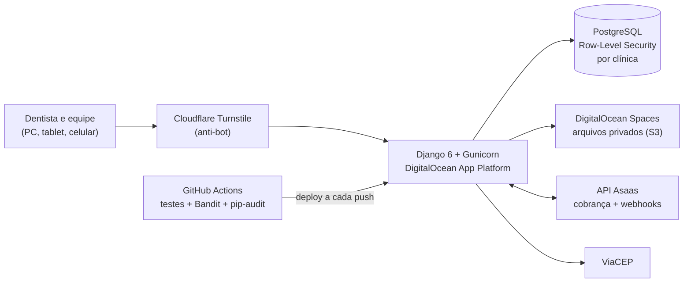

# Odonto Gold

**SaaS multi-tenant de gestão para consultórios odontológicos**: agenda, prontuário e anamnese com fotos, financeiro, cobrança recorrente e acesso por equipe, em uma única plataforma. Em produção, usado por clínicas e por uma instituição de pós-graduação em Odontologia.

🔗 **Site:** [www.odontogold.com.br](https://www.odontogold.com.br)

> Este repositório é uma **vitrine** do projeto. O código-fonte é privado por se tratar de um produto comercial. Fico à disposição para apresentar o código em uma conversa técnica.

---

## O problema

Consultórios pequenos e médios costumam controlar pacientes, anamneses e pagamentos em papel, planilhas e WhatsApp. Isso gera informação espalhada, retrabalho e risco de exposição de dados de saúde, que a LGPD classifica como sensíveis.

## A solução

O Odonto Gold centraliza a rotina do consultório em um sistema web acessível pelo computador, tablet ou celular:

- **Agenda** com status do atendimento por cores
- **Prontuário e anamnese** com fotos tiradas direto da câmera do celular
- **Financeiro** do consultório e **cobrança recorrente** da assinatura
- **Gestão de leads** para captação de novos pacientes
- **Equipes** com acesso compartilhado aos pacientes da mesma clínica
- **Multi-clínica:** os dados de cada clínica ficam isolados no próprio banco de dados

## Arquitetura

A aplicação é organizada em apps Django independentes: **contas, clínica, prontuário, financeiro, cobrança e leads**, com usuário customizado, middlewares próprios e management commands.

## Stack

| Camada | Tecnologias |
| --- | --- |
| Linguagens | Python 3.13, JavaScript, HTML, CSS, SQL |
| Back-end | Django 6, Gunicorn, WhiteNoise |
| Banco de dados | PostgreSQL com Row-Level Security (políticas versionadas em migrations) |
| Armazenamento | DigitalOcean Spaces (compatível com S3) via boto3 e django-storages |
| Infraestrutura | DigitalOcean App Platform (região Frankfurt, UE), configurada em `app.yaml` |
| CI/CD | GitHub Actions: testes, pip-audit e Bandit a cada push, com deploy automático |
| Integrações | API Asaas (assinaturas e webhooks), ViaCEP, links para WhatsApp |

## Segurança

- **Isolamento multi-tenant no banco:** políticas de Row-Level Security garantem que uma clínica nunca acesse dados de outra, mesmo em caso de erro na aplicação
- **Autenticação de dois fatores** (TOTP com QR Code)
- **Criptografia** de dados sensíveis em repouso
- **Bloqueio de conta** após tentativas de login falhas e expiração de senha
- **Anti-bot** com Cloudflare Turnstile
- **Arquivos privados** fora do servidor da aplicação
- **Análise estática (SAST)** com Bandit e auditoria de dependências com pip-audit no pipeline

## Qualidade

- Cerca de **157 testes automatizados** (Django TestCase)
- Medição de **cobertura** de testes
- **Mutation testing** com mutmut, para verificar se os testes realmente detectam falhas

## LGPD

- Registro das operações de tratamento de dados
- Acordos de processamento de dados (DPAs) com fornecedores
- Atuo como **Encarregado de Dados (DPO)** do produto
- Infraestrutura migrada dos EUA para a União Europeia (Frankfurt), incluindo o banco de dados

## Como usei IA no desenvolvimento

Desenvolvo no VS Code com o **Claude Code** como agente de programação, sempre com revisão humana e cobertura de testes:

- Prototipação de telas e validação do fluxo com dentistas antes do back-end
- Geração e revisão de código
- Criação de testes automatizados e de cenários de mutation testing
- Documentação técnica e documentos legais (Termos de Uso e Política de Privacidade)

## Autor

**Phelipe Lessa**, Analista e Desenvolvedor de Sistemas | IA aplicada | Python · Django

[LinkedIn](https://www.linkedin.com/in/phelipelessa/) · [GitHub](https://github.com/phelipepeluzio)
